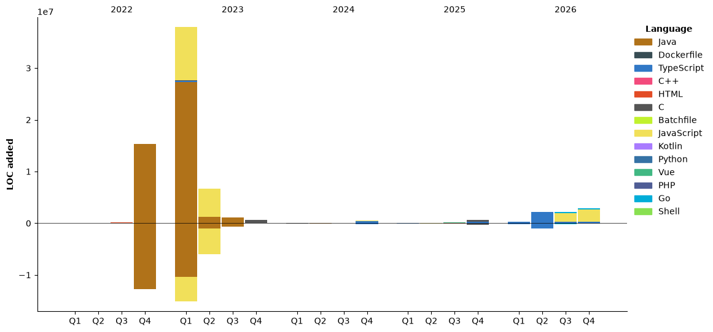

- 👋 Hi, I’m @TomyJan

- 🌐 [https://vov.moe](https://vov.moe)

## GitHub Stats

<div align="center">

  <!-- Snake -->
  <picture>
    <source media="(prefers-color-scheme: dark)" srcset="https://raw.githubusercontent.com/TomyJan/TomyJan/snake-output/github-contribution-grid-snake-dark.svg">
    <source media="(prefers-color-scheme: light)" srcset="https://raw.githubusercontent.com/TomyJan/TomyJan/snake-output/github-contribution-grid-snake.svg">
    
  </picture>

  <br><br>

  <!-- Stats + Top Languages -->
  <picture>
    <source media="(prefers-color-scheme: dark)" srcset="https://raw.githubusercontent.com/TomyJan/TomyJan/stats-output/stats-dark.svg">
    <source media="(prefers-color-scheme: light)" srcset="https://raw.githubusercontent.com/TomyJan/TomyJan/stats-output/stats-light.svg">
    
  </picture>&nbsp;&nbsp;&nbsp;&nbsp;<picture>
    <source media="(prefers-color-scheme: dark)" srcset="https://raw.githubusercontent.com/TomyJan/TomyJan/stats-output/top-langs-dark.svg">
    <source media="(prefers-color-scheme: light)" srcset="https://raw.githubusercontent.com/TomyJan/TomyJan/stats-output/top-langs-light.svg">
    
  </picture>

  <br>

</div>

## Token Usage Stats

<div align="center">

  <br>

  <!-- Tokens.ci -->
  [
    <picture>
      <source media="(prefers-color-scheme: dark)" srcset="https://tokens.ci/api/embed/TomyJan/svg?today=1&template=graph&rank=percent&tokens=compact&cost=compact">
      <source media="(prefers-color-scheme: light)" srcset="https://tokens.ci/api/embed/TomyJan/svg?theme=light&today=1&template=graph&rank=percent&tokens=compact&cost=compact">
      
    </picture>
  ](https://tokens.ci/u/TomyJan)

  <br>

</div>

## Wakatime Stats

<!--START_SECTION:waka-->


**🐱 我的 GitHub 数据** 

> 📦  使用了 71.8 MB GitHub 存储空间 
 > 
> 🏆 2,988 个贡献，在 2026 年
 > 
> 🚫 不开放招聘
 > 
> 📜 80 个公共仓库 
 > 
> 🔑 34 个私人仓库 
 > 
**我是夜猫 🦉** 

```text
🌞 早晨                     669 commits         ⬛⬛⬜⬜⬜⬜⬜⬜⬜⬜⬜⬜⬜⬜⬜⬜⬜⬜⬜⬜⬜⬜⬜⬜⬜   06.65 % 
🌆 白天                     2874 commits        ⬛⬛⬛⬛⬛⬛⬛⬜⬜⬜⬜⬜⬜⬜⬜⬜⬜⬜⬜⬜⬜⬜⬜⬜⬜   28.56 % 
🌃 傍晚                     3531 commits        ⬛⬛⬛⬛⬛⬛⬛⬛⬛⬜⬜⬜⬜⬜⬜⬜⬜⬜⬜⬜⬜⬜⬜⬜⬜   35.09 % 
🌙 晚上                     2988 commits        ⬛⬛⬛⬛⬛⬛⬛⬜⬜⬜⬜⬜⬜⬜⬜⬜⬜⬜⬜⬜⬜⬜⬜⬜⬜   29.70 % 
```
📅 **星期六 时的我最有干劲** 

```text
星期一                      1272 commits        ⬛⬛⬛⬜⬜⬜⬜⬜⬜⬜⬜⬜⬜⬜⬜⬜⬜⬜⬜⬜⬜⬜⬜⬜⬜   12.64 % 
星期二                      1173 commits        ⬛⬛⬛⬜⬜⬜⬜⬜⬜⬜⬜⬜⬜⬜⬜⬜⬜⬜⬜⬜⬜⬜⬜⬜⬜   11.66 % 
星期三                      1472 commits        ⬛⬛⬛⬛⬜⬜⬜⬜⬜⬜⬜⬜⬜⬜⬜⬜⬜⬜⬜⬜⬜⬜⬜⬜⬜   14.63 % 
星期四                      1468 commits        ⬛⬛⬛⬛⬜⬜⬜⬜⬜⬜⬜⬜⬜⬜⬜⬜⬜⬜⬜⬜⬜⬜⬜⬜⬜   14.59 % 
星期五                      1521 commits        ⬛⬛⬛⬛⬜⬜⬜⬜⬜⬜⬜⬜⬜⬜⬜⬜⬜⬜⬜⬜⬜⬜⬜⬜⬜   15.12 % 
星期六                      2507 commits        ⬛⬛⬛⬛⬛⬛⬜⬜⬜⬜⬜⬜⬜⬜⬜⬜⬜⬜⬜⬜⬜⬜⬜⬜⬜   24.92 % 
星期日                      649 commits         ⬛⬛⬜⬜⬜⬜⬜⬜⬜⬜⬜⬜⬜⬜⬜⬜⬜⬜⬜⬜⬜⬜⬜⬜⬜   06.45 % 
```


📊 **本周消耗时间** 

```text
🕑︎ 时区: Asia/Singapore

💬 编程语言: 
Other                    33 hrs 10 mins      ⬛⬛⬛⬛⬛⬛⬛⬛⬛⬜⬜⬜⬜⬜⬜⬜⬜⬜⬜⬜⬜⬜⬜⬜⬜   36.31 % 
Markdown                 28 hrs 19 mins      ⬛⬛⬛⬛⬛⬛⬛⬛⬜⬜⬜⬜⬜⬜⬜⬜⬜⬜⬜⬜⬜⬜⬜⬜⬜   31.01 % 
TypeScript               10 hrs 42 mins      ⬛⬛⬛⬜⬜⬜⬜⬜⬜⬜⬜⬜⬜⬜⬜⬜⬜⬜⬜⬜⬜⬜⬜⬜⬜   11.72 % 
JSON                     6 hrs 3 mins        ⬛⬛⬜⬜⬜⬜⬜⬜⬜⬜⬜⬜⬜⬜⬜⬜⬜⬜⬜⬜⬜⬜⬜⬜⬜   06.64 % 
PowerShell               4 hrs 57 mins       ⬛⬜⬜⬜⬜⬜⬜⬜⬜⬜⬜⬜⬜⬜⬜⬜⬜⬜⬜⬜⬜⬜⬜⬜⬜   05.42 % 

🔥 编辑器: 
VS Code                  39 hrs 28 mins      ⬛⬛⬛⬛⬛⬛⬛⬛⬛⬛⬛⬜⬜⬜⬜⬜⬜⬜⬜⬜⬜⬜⬜⬜⬜   43.22 % 
Chrome                   30 hrs 33 mins      ⬛⬛⬛⬛⬛⬛⬛⬛⬜⬜⬜⬜⬜⬜⬜⬜⬜⬜⬜⬜⬜⬜⬜⬜⬜   33.44 % 
Codex Vscode             21 hrs 19 mins      ⬛⬛⬛⬛⬛⬛⬜⬜⬜⬜⬜⬜⬜⬜⬜⬜⬜⬜⬜⬜⬜⬜⬜⬜⬜   23.34 % 

🐱‍💻 项目: 
MoeURL                   40 hrs 31 mins      ⬛⬛⬛⬛⬛⬛⬛⬛⬛⬛⬛⬜⬜⬜⬜⬜⬜⬜⬜⬜⬜⬜⬜⬜⬜   44.36 % 
tego-standard            8 hrs 30 mins       ⬛⬛⬜⬜⬜⬜⬜⬜⬜⬜⬜⬜⬜⬜⬜⬜⬜⬜⬜⬜⬜⬜⬜⬜⬜   09.31 % 
Donate                   8 hrs 24 mins       ⬛⬛⬜⬜⬜⬜⬜⬜⬜⬜⬜⬜⬜⬜⬜⬜⬜⬜⬜⬜⬜⬜⬜⬜⬜   09.21 % 
shcx-manager             7 hrs 26 mins       ⬛⬛⬜⬜⬜⬜⬜⬜⬜⬜⬜⬜⬜⬜⬜⬜⬜⬜⬜⬜⬜⬜⬜⬜⬜   08.14 % 
HomePage                 7 hrs 1 min         ⬛⬛⬜⬜⬜⬜⬜⬜⬜⬜⬜⬜⬜⬜⬜⬜⬜⬜⬜⬜⬜⬜⬜⬜⬜   07.68 % 

💻 操作系统: 
Windows                  91 hrs 21 mins      ⬛⬛⬛⬛⬛⬛⬛⬛⬛⬛⬛⬛⬛⬛⬛⬛⬛⬛⬛⬛⬛⬛⬛⬛⬛   100.00 % 
```

🤖 **AI Coding This Week** 

```text
⏱ AI Coding Time: 60 hrs 32 mins (66.26%)

✍️ 45,910 lines written by AI, 156 lines written by hand (99.66% AI-written)

🔤 142,991,459 Input Tokens, 10,699,174 Output Tokens

💵 $763.66 Estimated AI Cost This Week

🧠 253 AI Sessions, 490 AI Prompts

GPT                      46,204 lines        ⬛⬛⬛⬛⬛⬛⬛⬛⬛⬛⬛⬛⬛⬛⬛⬛⬛⬛⬛⬛⬛⬛⬛⬛⬛   100.00 % 

🔎 AI Coding Insights:
🤖 AI-Driven — 99.66% of written lines came from AI
📄 Detailed Prompter — average 1,389 characters per prompt
🔁 Iterative Prompter — average 2 prompts per session
🚀 High AI Trust — 0.5% of changed lines were hand-edited
```

**我最常使用 JavaScript** 

```text
JavaScript               25 repos            ⬛⬛⬛⬛⬛⬛⬜⬜⬜⬜⬜⬜⬜⬜⬜⬜⬜⬜⬜⬜⬜⬜⬜⬜⬜   23.58 % 
TypeScript               22 repos            ⬛⬛⬛⬛⬛⬜⬜⬜⬜⬜⬜⬜⬜⬜⬜⬜⬜⬜⬜⬜⬜⬜⬜⬜⬜   20.75 % 
Go                       8 repos             ⬛⬛⬜⬜⬜⬜⬜⬜⬜⬜⬜⬜⬜⬜⬜⬜⬜⬜⬜⬜⬜⬜⬜⬜⬜   07.55 % 
Python                   5 repos             ⬛⬜⬜⬜⬜⬜⬜⬜⬜⬜⬜⬜⬜⬜⬜⬜⬜⬜⬜⬜⬜⬜⬜⬜⬜   04.72 % 
Shell                    4 repos             ⬛⬜⬜⬜⬜⬜⬜⬜⬜⬜⬜⬜⬜⬜⬜⬜⬜⬜⬜⬜⬜⬜⬜⬜⬜   03.77 % 
```


**时间线**




 Last Updated on 01-11-2026 07:01:01 UTC
<!--END_SECTION:waka-->
